# Building, Hardening, and Automating a Production Linux Web Server

## Project Overview

This project documents the process of turning a clean Ubuntu Server virtual
machine into a working, verifiable, hardened, and partially automated Linux web
server. The project is intentionally presented as one evolving system: the
first phase builds and troubleshoots the service, the second phase reduces its
attack surface without losing administrative access, and the third phase turns
repeated administration checks into tested Bash automation.

The lab includes:

- validating the VM's compute, memory, storage, network, and operating-system baseline;
- updating the operating system and configuring the correct timezone;
- configuring SSH public-key authentication from a Windows host;
- deploying a static website through a custom Nginx server block;
- applying host firewall rules with UFW;
- verifying services, listening ports, HTTP responses, and logs;
- troubleshooting controlled HTTP and permission scenarios;
- hardening SSH, users, groups, permissions, and running services;
- adding Fail2ban protection and auditing authentication logs; and
- confirming SSH, Nginx, UFW, Fail2ban, and security policy persistence after
  a reboot;
- creating Bash scripts for system information, disk usage, service health,
  backup, and safe log cleanup; and
- scheduling service-health checks with a persistent systemd timer.

This is a production-style learning environment running on a private VMware NAT
network. It is not presented as a fully production-ready internet-facing
system; TLS, centralized monitoring, off-host backups, full disaster recovery,
and external network controls remain outside this lab's scope.

## Architecture

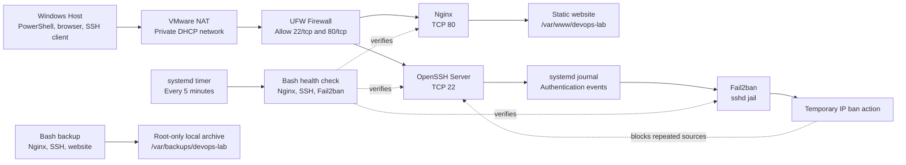

The Windows host reaches the Ubuntu VM through VMware NAT. UFW denies
unsolicited inbound traffic by default and permits only SSH and HTTP for this
lab. OpenSSH provides key-only administrative access with a passphrase-protected
client key. Fail2ban monitors SSH authentication events through the systemd
journal. Nginx listens on port 80 and serves the static website from
`/var/www/devops-lab`.

The VM uses a DHCP-provided private address on `ens33`, so its IP address is not
treated as permanent configuration. The website content is owned by the normal
administrative user, while the Nginx worker runs as `www-data` with read-only
access to the static files.

## Technologies

| Layer | Technology | Purpose |
| --- | --- | --- |
| Host and virtualization | Windows, VMware Workstation | Runs and manages the lab VM |
| Guest operating system | Ubuntu Server 26.04 LTS | Provides the Linux server environment |
| Networking | VMware NAT, DHCP, `iproute2` | Provides private host-to-VM connectivity and network diagnostics |
| Remote administration | OpenSSH, Ed25519 keys | Provides encrypted remote shell access |
| Web server | Nginx 1.28 | Serves the static website over HTTP |
| Service management | systemd | Manages service startup, status, reloads, and boot persistence |
| Host firewall | UFW | Applies default-deny inbound filtering and explicit service rules |
| Brute-force protection | Fail2ban | Monitors SSH failures through an active `sshd` jail |
| Diagnostics | `curl`, `ss`, `systemctl`, `journalctl`, service logs | Verifies each layer and supports troubleshooting |
| Automation | Bash, systemd timers | Runs repeatable health, disk, backup, and cleanup tasks |
| Backup | GNU `tar` | Creates and verifies local compressed configuration/content archives |
| Version control | Git | Tracks the website, configuration example, and documentation |

## Repository Structure

```text
.
├── .gitattributes
├── .gitignore
├── README.md
├── configs/
│   ├── fail2ban/
│   │   └── sshd.local
│   ├── nginx/
│   │   └── devops-lab.conf
│   ├── ssh/
│   │   └── 00-lab-hardening.conf
│   └── systemd/
│       ├── server-health.service
│       └── server-health.timer
├── docs/
│   ├── HARDENING-BEFORE-AFTER.md
│   ├── LAB-02-HARDENING.md
│   └── LAB-03-AUTOMATION.md
├── screenshots/
│   ├── 01-custom-site-browser.png
│   ├── 02-final-server-validation.png
│   ├── 03-controlled-404-response.png
│   ├── 04-access-log-verification.png
│   ├── lab-02/
│       ├── 01-effective-ssh-hardening.png
│       ├── 02-critical-file-permissions.png
│       ├── 03-fail2ban-sshd-jail.png
│       └── 04-post-reboot-validation.png
│   └── lab-03/
│       ├── 01-system-information.png
│       ├── 02-disk-and-service-checks.png
│       ├── 03-backup-verification.png
│       ├── 04-log-cleanup-journal.png
│       └── 05-systemd-timer-success.png
├── scripts/
│   ├── disk-monitor.sh
│   ├── log-cleanup.sh
│   ├── server-backup.sh
│   ├── service-health.sh
│   └── system-info.sh
└── site/
    └── index.html
```

- [`configs/nginx/devops-lab.conf`](configs/nginx/devops-lab.conf) is the
  version-controlled copy of the active Nginx server block.
- [`site/index.html`](site/index.html) is the static page deployed to the
  server.
- [`configs/ssh/00-lab-hardening.conf`](configs/ssh/00-lab-hardening.conf) and
  [`configs/fail2ban/sshd.local`](configs/fail2ban/sshd.local) are the
  secret-free copies of the active hardening policy.
- [`docs/LAB-02-HARDENING.md`](docs/LAB-02-HARDENING.md) documents the hardening
  phase in Turkish; [`docs/HARDENING-BEFORE-AFTER.md`](docs/HARDENING-BEFORE-AFTER.md)
  contains the measured baseline comparison.
- [`docs/LAB-03-AUTOMATION.md`](docs/LAB-03-AUTOMATION.md) documents the Bash
  automation phase, exit-code tests, backup safety, and systemd timer behavior.
- [`scripts/`](scripts) contains the five tested administration scripts;
  [`configs/systemd/`](configs/systemd) contains the secret-free health-check
  service and timer definitions.
- The repository does not contain passwords, private keys, tokens, or other
  credentials.

## Phase 1 — Web Server Build and Troubleshooting

1. **Validated the server baseline.** I inspected the hostname, user and sudo
   context, CPU, memory, LVM-backed storage, filesystem usage, network address,
   default route, and existing SSH session before changing the VM.

2. **Prepared the operating system.** I refreshed the APT package metadata,
   reviewed the available upgrades, installed the updates, and configured the
   system timezone for `Europe/Istanbul`.

3. **Configured key-based SSH access.** I generated a passphrase-protected
   Ed25519 key pair on the Windows host, installed only the public key in the
   Ubuntu user's `authorized_keys` file, applied restrictive SSH file
   permissions, and verified a new key-authenticated session.

4. **Installed and validated Nginx.** I confirmed that the service was both
   running and enabled, identified its master and worker processes, and verified
   that it was listening on TCP port 80 for IPv4 and IPv6.

5. **Deployed a dedicated website.** The static page was copied to
   `/var/www/devops-lab`. A dedicated server block was created under
   `sites-available` and enabled with a symbolic link in `sites-enabled`. The
   Ubuntu default site was disabled without deleting its source configuration.

6. **Applied a predictable permission model.** The normal administrative user
   owns the website content. Directories use mode `755` and static files use
   mode `644`, allowing the `www-data` Nginx worker to read the content without
   granting it write access.

7. **Configured the host firewall.** UFW uses `deny incoming` and
   `allow outgoing` defaults. The OpenSSH rule was added before enabling the
   firewall to reduce lockout risk, followed by the Nginx HTTP rule.

8. **Tested before reloading.** Nginx configuration changes were checked with
   `nginx -t` before a graceful reload. HTTP responses and Nginx access logs were
   then used to verify the active configuration.

9. **Verified persistence.** After rebooting the VM, I reconnected with the SSH
   key and confirmed that Nginx, UFW, and HTTP access returned automatically.

## Phase 2 — Linux Server Hardening

1. **Prepared recovery access and measured a baseline.** A VMware snapshot,
   console login, and independent SSH-key session were verified before changing
   authentication. Effective SSH values, listening ports, and UFW policy were
   recorded for comparison.

2. **Applied SSH hardening through a drop-in.** A dedicated
   `00-lab-hardening.conf` was loaded before cloud-init's configuration. Root
   and password login were disabled, key authentication was retained,
   unnecessary forwarding was disabled, retry/grace limits were reduced, and
   SSH access was restricted to the administrative user.

3. **Validated behavior before closing recovery paths.** SSH syntax and
   effective configuration were checked before reload. A new key-only session
   succeeded, a password-only attempt failed, and the existing session remained
   connected.

4. **Audited least privilege and critical permissions.** The only normal user,
   sudo rights, locked root password, SSH key permissions, and sensitive system
   file modes were reviewed. An unused `lxd` group membership was removed while
   required sudo access was preserved.

5. **Reduced the service attack surface.** TCP and UDP listeners were matched
   to their processes. Unused `ModemManager` and `multipathd` services were
   stopped and disabled; required DHCP, DNS, time, SSH, and web functions were
   preserved.

6. **Enabled Fail2ban for SSH.** A systemd-journal-backed `sshd` jail was
   configured for five failures within ten minutes and a ten-minute ban. The
   configuration test, service state, jail state, and logs were verified.

7. **Repeated acceptance checks after reboot.** Key-only SSH access, active
   SSH/Nginx/Fail2ban services, effective root/password restrictions, active
   `sshd` jail, and disabled unnecessary services all persisted.

## Phase 3 — Bash Server Automation

1. **Established a restricted working layout.** Scripts and operational logs
   were separated under `/home/yagiz/server-automation`; sensitive system
   archives were written to root-owned `/var/backups/devops-lab`.

2. **Created a system-information report.** A reusable script collects the
   hostname, user, uptime, memory, root-filesystem usage, and global IP address
   while appending the same output to a local log.

3. **Added actionable disk and service checks.** Disk usage is compared with a
   validated threshold, while Nginx, SSH, and Fail2ban are checked in a loop.
   Healthy, unhealthy, and invalid-input paths return distinct exit codes.

4. **Created and verified local backups.** Nginx, SSH, and website content are
   archived with a timestamp under a root-only directory. The resulting
   archive is immediately read with `tar -tzf` so a successful command is not
   mistaken for a usable backup.

5. **Implemented safe log cleanup.** Cleanup is restricted to the lab log
   directory, validates its retention input, defaults to dry-run, and requires
   an explicit `--delete` flag. Both paths were tested with a controlled old
   file and recorded in the journal.

6. **Scheduled service-health checks.** A `oneshot` systemd service runs as the
   normal administrative user, and a persistent timer triggers it every five
   minutes. Manual and timer-triggered executions completed successfully.

## Security Considerations

Implemented controls:

- Daily administration uses a normal user with `sudo`; the root account is not
  used as the interactive working account.
- The SSH private key remains on the Windows host, is protected by a
  passphrase, and is excluded from version control. Only the public key is
  installed on the server.
- SSH password authentication and direct root login are disabled. Only the
  explicitly allowed administrative user can connect with a public key.
- Unused SSH X11, agent, and TCP forwarding features are disabled; connection
  retries and authentication grace time are reduced.
- Fail2ban runs an `sshd` jail that monitors authentication events through the
  systemd journal.
- UFW denies unsolicited inbound traffic by default. Only TCP 22 (SSH) and TCP
  80 (HTTP) are allowed for this lab.
- The unused `lxd` group membership and unnecessary ModemManager/multipathd
  services were removed from the active privilege and service surface.
- Website write access belongs to the administrative user. Nginx serves the
  content through its unprivileged `www-data` workers.
- Nginx configuration is syntax-tested before reload, reducing the risk of
  applying a broken configuration.
- The repository includes ignore rules for environment files, private-key
  formats, editor metadata, logs, and temporary files. Staged changes will also
  be reviewed before every commit because `.gitignore` is not a secret scanner.
- Cleanup defaults to dry-run and is constrained to the known lab-log path;
  system and Nginx logs remain under the operating system's logrotate policy.
- System backups require root, validate every expected source, use a root-only
  destination directory, and verify that the resulting archive can be listed.
- The scheduled health check runs as `yagiz`, not root, because reading service
  state does not require administrative write privileges.

Known limitations:

- The site currently uses plain HTTP and does not provide TLS encryption.
- The VM is reachable only through the private VMware NAT lab network and has
  not been exposed directly to the internet.
- The server uses DHCP; its private IP address may change after a lease renewal
  or network restart.
- Fail2ban configuration and the active jail were verified, but the automatic
  ban threshold was not triggered end-to-end from a separate attack client.
- Backups currently remain on the same VM; off-host copies and full restore or
  disaster-recovery testing have not yet been implemented.
- Only the service-health check is scheduled. Disk, backup, cleanup, and system
  information scripts remain manual to avoid duplicating timers solely for the
  lab demonstration.
- Centralized monitoring, TLS, and external network controls remain outside
  this lab's scope.

## Troubleshooting

### Incorrect document-root location

The website directory was initially created as `/var/www/html/devops-lab`,
which would make it a child of Ubuntu's default document root rather than an
independent site root. I compared the filesystem path with the intended Nginx
`root`, moved the directory to `/var/www/devops-lab`, and verified the final URL
mapping through the custom server block.

### systemd unit-change warning

An Nginx reload reported that the unit file or its source had changed on disk.
This was not treated as an Nginx syntax error. The systemd manager configuration
was refreshed with `systemctl daemon-reload`, the Nginx configuration was tested
again, and only then was the service gracefully reloaded. A subsequent HTTP
request confirmed availability.

### Controlled `404 Not Found`

A request to `/does-not-exist` returned `404`, while `/` continued to return
`200`. The access log recorded both results. The current error log remained
empty because `try_files $uri $uri/ =404` intentionally converts a missing
static resource into a controlled HTTP response; not every `4xx` response is a
runtime server error.

### Permission experiment

A controlled permission change did not initially produce the expected denial.
Instead of forcing a conclusion, I checked the Nginx worker identity and group
membership and tested file reads as `www-data`. Because the experiment remained
inconclusive without further ACL evidence, I did not claim an unsupported root
cause. I restored the known-good `755` directory and `644` file policy and
verified the site again with `200 OK`.

### Timer referenced a missing service unit

The first `server-health.timer` start failed because its referenced
`server-health.service` file had not been saved. Listing and reading the unit
paths exposed the missing file. After creating it and running
`systemctl daemon-reload`, the service completed with `status=0/SUCCESS` and
the timer displayed its next scheduled activation.

## Verification

| Check | Evidence |
| --- | --- |
| Nginx configuration | `nginx -t` reported valid syntax and a successful test |
| Service state | Nginx reported `active` and `enabled` |
| Listening sockets | `ss` showed `sshd` on TCP 22 and Nginx on TCP 80 for IPv4 and IPv6 |
| Firewall policy | UFW reported `active`, default-deny incoming, and only SSH/HTTP inbound rules |
| Local HTTP request | `curl -I http://127.0.0.1/` returned `HTTP/1.1 200 OK` |
| Host-to-VM request | Windows `curl.exe -I` returned `HTTP/1.1 200 OK` through the NAT network |
| SSH authentication | A forced public-key-only test returned the expected hostname and Nginx state |
| Logging | Nginx access logs recorded both successful and controlled `404` requests |
| Effective SSH policy | `sshd -T` reported password/root login and unused forwarding disabled |
| Least privilege | Root password remained locked and the unused `lxd` group membership was removed |
| Critical permissions | System, sudo, SSH directory, and `authorized_keys` modes matched the secure baseline |
| Fail2ban | Configuration test passed; service and `sshd` jail reported active |
| Service reduction | ModemManager and multipathd reported inactive after being disabled |
| Reboot persistence | Key-only SSH, Nginx, Fail2ban, hardening policy, and disabled services persisted |
| Script syntax | All five Bash scripts passed `bash -n` |
| Exit-code behavior | Disk and service scripts returned distinct success, operational-warning, and invalid-input codes |
| Local backup | A timestamped archive was created under `/var/backups/devops-lab` and passed `tar -tzf` verification |
| Safe cleanup | Dry-run listed the controlled old log before explicit deletion; journal recorded both actions |
| Scheduled automation | `server-health.service` completed successfully and `server-health.timer` reported enabled, active, and a next run |

The final acceptance path was:

```text
valid configuration
→ active and boot-enabled service
→ listening socket
→ permitted firewall rule
→ successful host-to-VM HTTP response
→ effective SSH hardening and active Fail2ban jail
→ successful reboot test
→ tested Bash health and maintenance scripts
→ active systemd health-check timer
```

## Verification Evidence

### Website reached from the Windows host

The custom page was served by the Ubuntu VM and opened from the Windows host
through the private VMware NAT network.

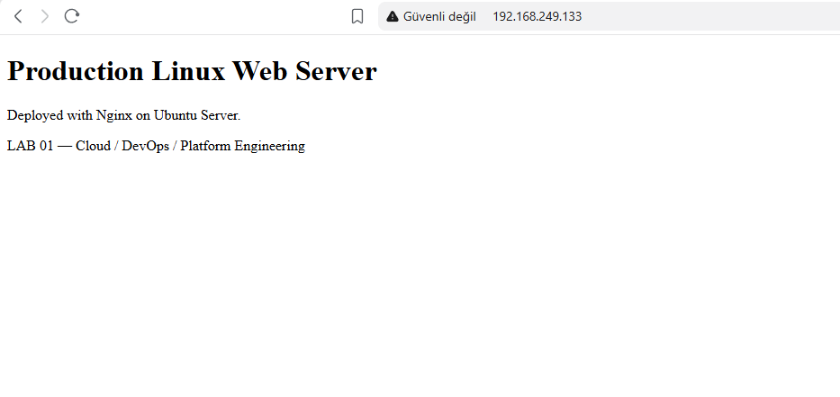

### Final server-side validation

The final acceptance check confirmed valid Nginx configuration, active and
boot-enabled service state, SSH and HTTP listening sockets, and the expected UFW
policy.

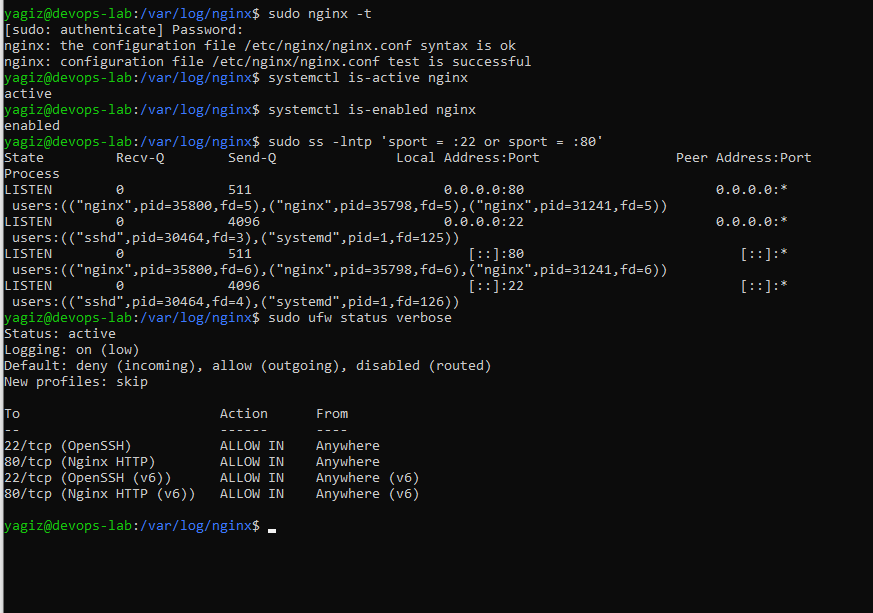

### Controlled 404 response

Requesting a missing path returned the expected Nginx `404 Not Found` response
without affecting the working root page.

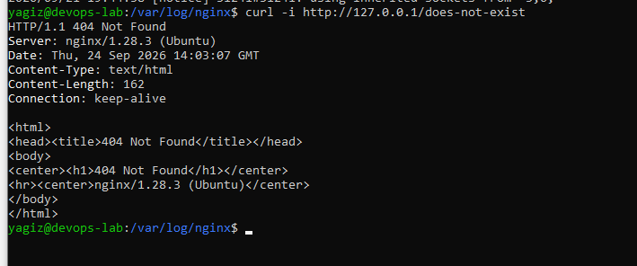

### Access-log verification

The access log recorded both the successful root request and the controlled
missing-resource request with their respective `200` and `404` status codes.

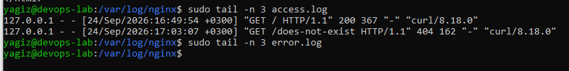

### Effective SSH hardening policy

The effective SSH configuration confirmed that root/password authentication
and unused forwarding features were disabled while public-key access remained
enabled.

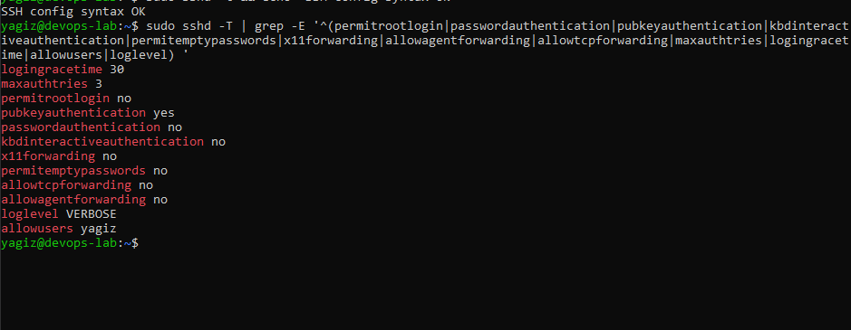

### Critical file permissions

Sensitive system, sudo, SSH, and hardening configuration paths were checked for
the expected ownership and restrictive modes.

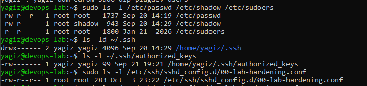

### Active Fail2ban SSH jail

Fail2ban loaded the `sshd` jail and matched SSH events from the systemd journal.

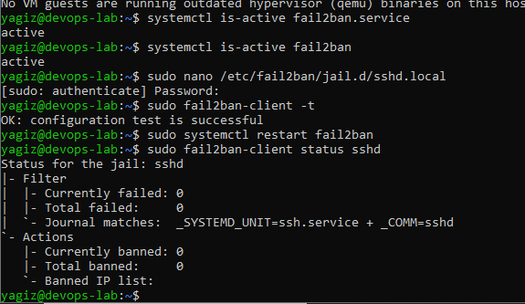

### Post-reboot hardening validation

After reboot, SSH, Nginx, and Fail2ban were active; root/password SSH remained
disabled; and the unnecessary services remained inactive.

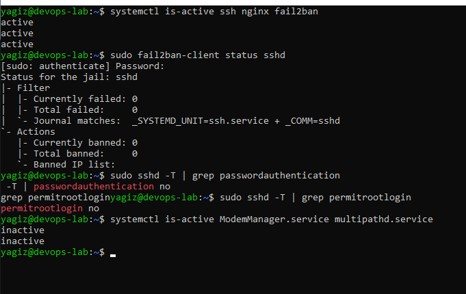

### Bash system-information report

The first automation script reported the host, user, uptime, memory, root
filesystem, and active global address while appending the same output to its
log file.

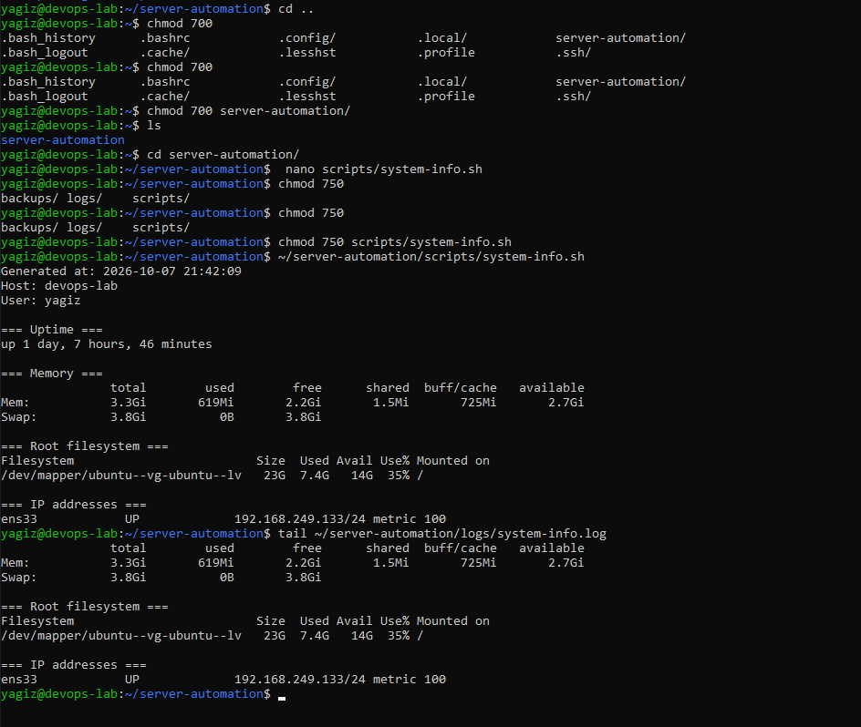

### Disk and service failure paths

The disk monitor distinguished syntax success, threshold warning, and invalid
input with explicit exit codes. The service checker reported all real services
healthy and returned failure for a controlled nonexistent service.

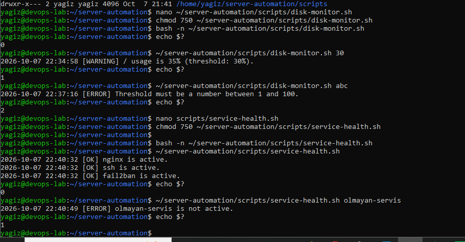

### Root-owned backup and journal evidence

The backup directory was restricted to root, the timestamped archive was
created successfully, and the operation was recorded through the journal.

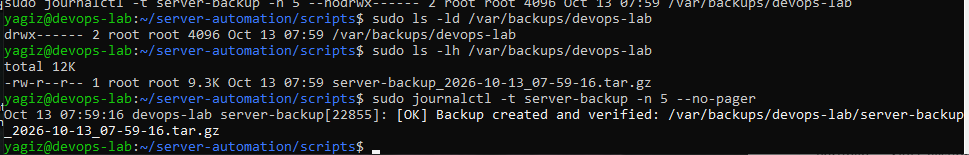

### Dry-run-first log cleanup

The cleanup script recorded that the controlled old log was deleted while the
remaining current logs were preserved.

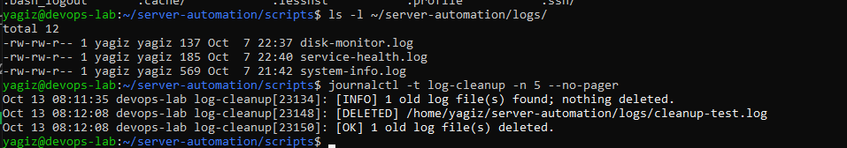

### Successful systemd service and timer

The oneshot service completed with `status=0/SUCCESS`; its timer remained
active and displayed the next scheduled run.

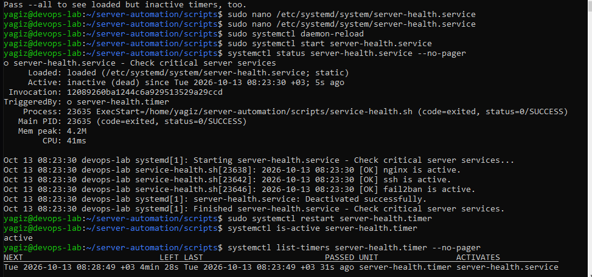

## What I Learned

- A successful package installation does not prove that a service is usable;
  configuration, process state, sockets, firewall rules, application responses,
  and logs must be checked as separate layers.
- SSH public-key authentication proves possession of the private key without
  sending that private key to the server. A key passphrase protects the local
  private-key file and is different from the remote account password.
- Nginx configuration and website content have different responsibilities:
  `/etc/nginx` defines how requests are handled, while `/var/www` stores the
  content being served.
- `sites-available` stores candidate configurations and `sites-enabled`
  determines which sites Nginx loads through symbolic links.
- Linux directory permissions require the execute bit for traversal, which is
  why static-site directories and files use different modes (`755` and `644`).
- Configuration should be tested before reload, and a graceful reload is
  preferable when a restart is unnecessary.
- HTTP status codes must be interpreted with logs and request context. A
  controlled `404` is different from a stopped service, a refused connection,
  or a firewall timeout.
- Good troubleshooting records observations, hypotheses, checks, conclusions,
  and verification without inventing a root cause when evidence is incomplete.
- Hardening should begin with recovery access and a measured baseline rather
  than with random configuration changes.
- A configuration file's contents are not sufficient evidence; `sshd -T`
  reveals the effective policy after includes, defaults, and ordering.
- Least privilege includes group memberships and running daemons, not only
  user accounts and file modes.
- Security documentation must distinguish between a configured control and an
  end-to-end test that was actually performed.
- Automation becomes reliable when success, operational failure, and invalid
  input produce deliberate exit codes instead of only human-readable output.
- A safe cleanup task should be path-constrained and dry-run by default; an
  explicit destructive mode is easier to review and test.
- A backup is stronger when its expected sources are validated and the archive
  is checked immediately, but local archive validation is still not equivalent
  to an off-host restore or disaster-recovery test.
- A systemd `.service` defines what runs, while a `.timer` defines when it runs;
  a successful `oneshot` service normally returns to `inactive (dead)`.
