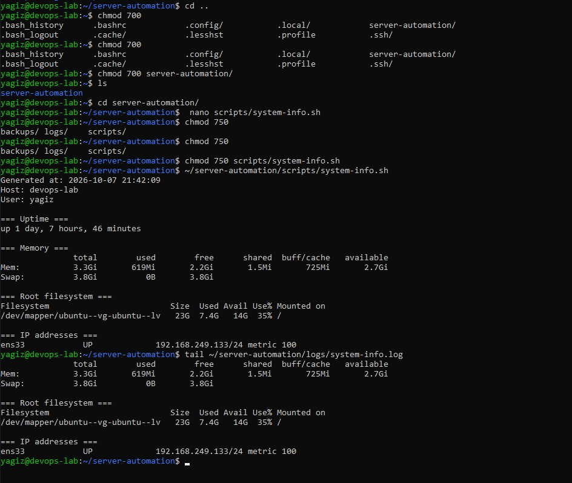
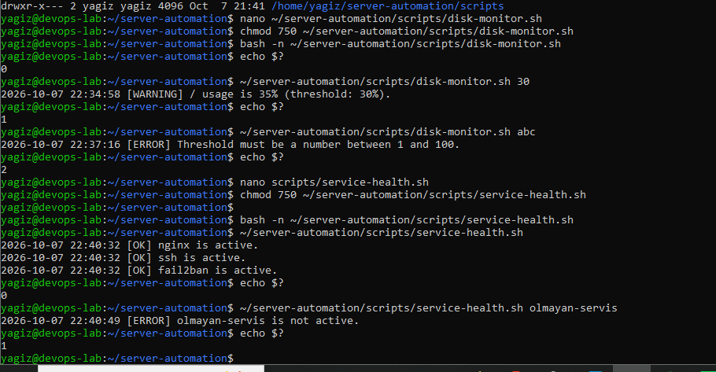
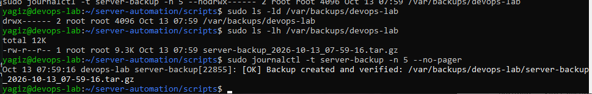
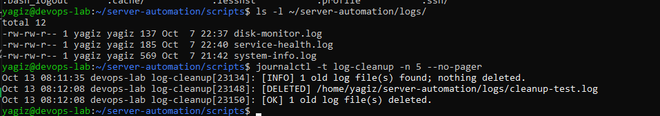
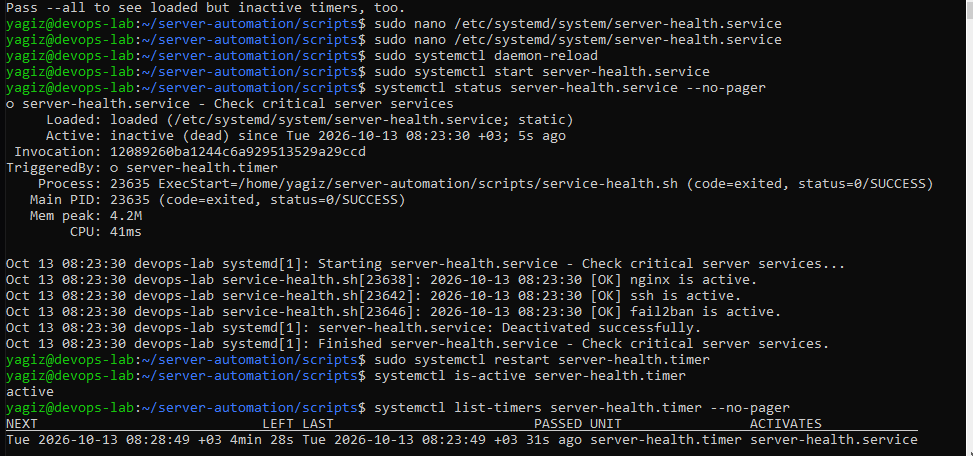

# LAB 03 — Bash ile Linux Sunucu Otomasyonu

## Amaç

LAB 01'de kurulan ve LAB 02'de sertleştirilen Ubuntu/Nginx sunucusunda tekrar
eden yönetim kontrollerini Bash scriptleriyle daha tutarlı ve tekrar
çalıştırılabilir hâle getirmek amaçlandı. Odak, yalnızca komutları bir dosyaya
yazmak değil; girdi doğrulama, hata yönetimi, exit code, loglama ve güvenli
varsayılanlar kullanmaktı.

## Çalışma düzeni

Sunucuda aşağıdaki yapı kullanıldı:

```text
/home/yagiz/server-automation/
├── scripts/
├── logs/
└── backups/
```

Ana dizin, scriptler ve loglar `750`; kullanıcı alanındaki backup dizini ise
`700` olarak sınırlandırıldı. Gerçek sistem yedekleri hassas SSH ve Nginx
ayarları içerdiği için root sahipliğindeki `/var/backups/devops-lab` dizinine
yazıldı.

## Oluşturulan scriptler

| Script | Görev | Önemli davranış |
| --- | --- | --- |
| `system-info.sh` | Uptime, bellek, disk ve IP bilgisini toplar | Sonucu hem terminale hem log dosyasına yazar |
| `disk-monitor.sh` | Root filesystem kullanımını eşikle karşılaştırır | Sağlıklı durumda `0`, eşik aşımında `1`, hatalı girdide `2` döndürür |
| `service-health.sh` | Nginx, SSH ve Fail2ban durumunu kontrol eder | Tüm servisleri kontrol eder ve herhangi biri kapalıysa `1` döndürür |
| `server-backup.sh` | Nginx, SSH ve web sitesi dosyalarını arşivler | Root yetkisi ister ve oluşan arşivi `tar -tzf` ile doğrular |
| `log-cleanup.sh` | Eski lab loglarını bulur ve isteğe bağlı siler | Varsayılan olarak dry-run çalışır; yalnızca açık `--delete` seçeneğiyle siler |

Scriptlerde `set -euo pipefail`, değişkenler, fonksiyonlar, koşullar, diziler,
döngüler ve anlamlı exit code'lar kullanıldı. `bash -n` ile söz dizimi kontrolü
yapıldı.

## Disk ve servis kontrolleri

Disk kontrolü varsayılan `%80` eşiğiyle çalışır. Gerçek disk kullanımı eşik
altındayken `0`, kontrollü olarak `%30` eşiği verildiğinde `WARNING` ve `1`,
sayısal olmayan eşik verildiğinde ise `ERROR` ve `2` üretti.

Servis kontrolü Nginx, SSH ve Fail2ban için başarılı sonuç verdi. Gerçek bir
servisi durdurmak yerine var olmayan bir servis adıyla hata yolu test edildi;
script `1` döndürdü. Böylece çalışan sunucunun erişilebilirliği test uğruna
riske atılmadı.

## Güvenli backup yaklaşımı

Backup scripti şu kaynakları kapsar:

- `/etc/nginx`
- `/etc/ssh/sshd_config`
- `/etc/ssh/sshd_config.d`
- `/var/www/devops-lab`

Script root dışında çalıştırılırsa `2` ile çıkar. Kaynaklardan biri yoksa
arşiv oluşturmadan hata verir. Başarılı çalışmada zaman damgalı `.tar.gz`
dosyası `/var/backups/devops-lab` altında oluşturulur ve arşiv listesi okunarak
bütünlük kontrolü yapılır.

Canlı sistemin üzerine geri yükleme yapılmadı. Arşivin açılabilirliği script
içindeki `tar -tzf` doğrulamasıyla kontrol edildi; bu nedenle çalışma tam bir
disaster-recovery testi olarak sunulmamaktadır.

## Güvenli log temizliği

Log temizleme scripti yalnızca
`/home/yagiz/server-automation/logs` dizinindeki `.log` dosyalarını hedefler.
Retention değeri `1–365` gün arasında doğrulanır. Varsayılan `--dry-run` modu
hangi dosyaların silineceğini gösterir ancak dosya sistemini değiştirmez.

On gün eski kontrollü bir test dosyasıyla önce dry-run, ardından `--delete`
senaryosu doğrulandı. İşlemler `logger` aracılığıyla systemd journal'a
kaydedildi. Sistem veya Nginx logları bu scriptle temizlenmedi; bu logların
yönetimi işletim sisteminin `logrotate` politikasına bırakıldı.

## systemd timer

`service-health.sh` için bir `oneshot` service ve beş dakikalık timer
oluşturuldu:

- `server-health.service` görevin ne çalıştıracağını tanımlar.
- `server-health.timer` görevin boot sonrasında ve beş dakikalık aralıklarla
  ne zaman çalışacağını tanımlar.

Service normal kullanıcı `yagiz` olarak çalışır. `oneshot` görev tamamlandıktan
sonra service'in `inactive (dead)` görünmesi normaldir; sürekli aktif kalan
bileşen timer'dır.

İlk denemede timer dosyası oluşturulmuş fakat service dosyası kaydedilmemişti.
Systemd `unit server-health.service to trigger not loaded` hatası verdi. Eksik
service dosyası oluşturulup `systemctl daemon-reload` çalıştırıldıktan sonra
manuel service testi `status=0/SUCCESS` ile tamamlandı ve timer yaklaşan çalışma
zamanını gösterdi.

Disk, backup ve cleanup scriptleri için ilave timer oluşturulmadı. Tek bir
çalışan timer, otomasyon yaklaşımını göstermek için yeterli tutuldu; lab
ortamında aynı kalıbı gereksiz yere çoğaltmaktan kaçınıldı.

## Doğrulama

| Kontrol | Sonuç |
| --- | --- |
| Beş script için `bash -n` | Başarılı |
| Sistem bilgi raporu ve log kaydı | Başarılı |
| Disk sağlıklı/eşik aşımı/hatalı girdi yolları | Sırasıyla `0`, `1`, `2` |
| Üç gerçek servisin kontrolü | Başarılı, exit code `0` |
| Var olmayan servis testi | Beklenen hata, exit code `1` |
| Backup oluşturma ve arşiv doğrulama | Başarılı, exit code `0` |
| Log cleanup dry-run ve delete testi | Başarılı |
| `server-health.service` manuel çalıştırma | `status=0/SUCCESS` |
| `server-health.timer` | Enabled ve active |

## Kanıt ekran görüntüleri

### Sistem bilgi raporu



### Disk ve servis kontrol senaryoları



### Backup ve journal doğrulaması



### Log cleanup sonucu



### systemd timer sonucu



## Repository güvenliği

Repository yalnızca scriptleri ve secret içermeyen systemd unit örneklerini
içerir. Çalışma logları, oluşturulan backup arşivleri, SSH private key'i,
parolalar ve tokenlar repository'ye eklenmez. Shell ve systemd dosyaları Linux
üzerinde bozulmaması için Git'te LF satır sonuyla korunur.

## Sonuç

Sunucu yönetim kontrolleri tekrar kullanılabilir scriptlere dönüştürüldü.
Scriptlerin yalnızca başarı yolunu değil; eşik aşımı, hatalı girdi, eksik
servis, eksik kaynak ve güvenli silme davranışlarını da açık exit code ve
loglarla bildirmesi sağlandı. Systemd timer ile servis sağlığı kontrolü manuel
komuttan zamanlanmış bir operasyona taşındı.
